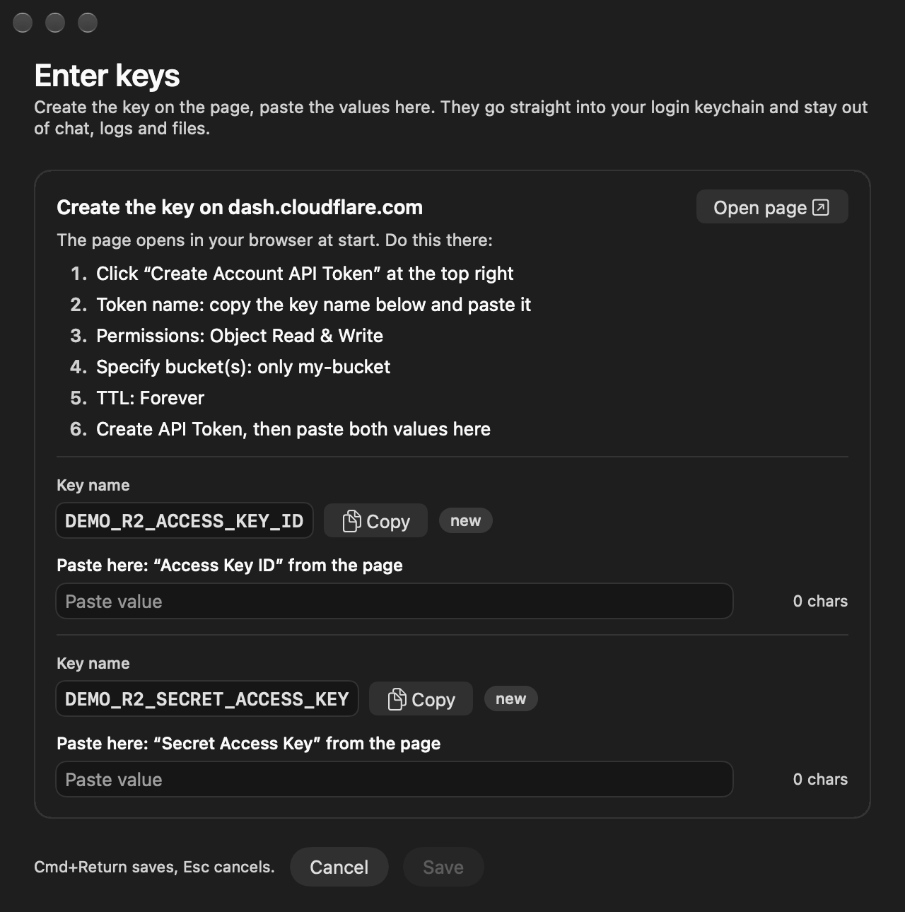

# key-intake

A small macOS window that takes API keys from a person and puts them straight into the login keychain — without the value ever passing through a terminal, a chat, a log or a file.

Built for working with coding agents: the agent needs a token, but it should never see the token. Instead of asking you to paste it into the chat, the agent runs `key-intake`. A window opens next to the page where you create the key, with numbered steps for that page. You paste the value, press Cmd+Return, and the agent gets back one line: `stored NAME`. From then on it reads the value with `security find-generic-password -s NAME -w`, inline, at the moment it needs it.



## Requirements

- macOS 12 or later
- Swift compiler (`swiftc`) from the Xcode Command Line Tools (`xcode-select --install`) — the app is compiled from source on first run; no other dependencies

## Install

```bash
git clone https://github.com/noelboss/key-intake.git
ln -s "$PWD/key-intake/key-intake" ~/.local/bin/key-intake   # any folder on your PATH
```

The first call compiles the app into `~/.local/share/key-intake/KeyIntake.app` (ad-hoc signed, own Dock icon). It is rebuilt automatically whenever the sources change.

## Usage

```bash
key-intake R2_ACCESS_KEY_ID="Access Key ID" R2_SECRET_ACCESS_KEY="Secret Access Key" \
  --url "https://dash.cloudflare.com/?to=/:account/r2/api-tokens" \
  --steps "Create Account API Token | Permissions: Object Read & Write | Buckets: only my-bucket | TTL: Forever | Create, then copy both values"
```

- `NAME` becomes the keychain service name. The optional `="label"` tells the person which value on the page belongs in this row.
- Every group of names ends with `--url` (the exact https page where the key is created) and `--steps` (what to do there, separated by `|`, at most 12). Names from the same page share one group; one call can hold several groups.
- The window opens the first page at start and stays on top beside the browser.
- The window has no timeout: it waits until the person saves or cancels (Cancel, Esc or Cmd+Q).
- Output, one line per name: `stored NAME`, `skipped NAME` or `failed NAME <reason>`.
- Exit code: `0` at least one value stored · `1` cancelled or nothing stored · `2` error (bad arguments, build failure, or any `failed` line).

An agent should start it in the background: the window waits for the person.

If a name already exists, the row says so and only overwrites after the person ticks "replace". If a name exists more than once, the row is locked until the duplicates are cleaned up.

### Where the value lands and how to read it

Each value becomes a generic password item in the login keychain: service = `NAME`, account = `KEY_INTAKE_ACCOUNT` (default: your user name). Read it back inline, at the moment a command needs it, and never echo it:

```bash
curl -H "Authorization: Bearer $(security find-generic-password -s NAME -w)" https://api.example.com/
```

### Environment

| Variable | Effect | Default |
|---|---|---|
| `KEY_INTAKE_ACCOUNT` | account for new entries (existing entries keep theirs) | your user name |
| `KEY_INTAKE_BROWSER` | app that opens the page, e.g. `Firefox` | default browser |
| `KEY_INTAKE_LANG` | window language, `en` or `de` | first system language |
| `KEY_INTAKE_ON_STORE` | executable started in the background after at least one value was stored (e.g. to refresh a secret-redaction list) | none |
| `KEY_INTAKE_BIN_DIR` | where the app is built | `~/.local/share/key-intake` |
| `KEY_INTAKE_SNAPSHOT` | render the window into this PNG and exit — nothing is stored, no page opens (used for the screenshot above) | none |

## Agent skill

`skills/key-intake/SKILL.md` teaches a coding agent (Claude Code skill format) when and how to call `key-intake`: never ask for a secret in chat, start the window in the background with the page URL and numbered steps, read the value back inline. Install it by copying or symlinking the folder:

```bash
ln -s "$PWD/key-intake/skills/key-intake" ~/.claude/skills/key-intake
```

## Security model

- **The value only goes into the keychain.** It travels from the secure text field over a pipe into `/usr/bin/security -i`, hex-encoded. It never appears in `argv` (so not in `ps` or shell history), never on stdout or stderr, never in a file.
- **The keychain item belongs to `security`.** Because `/usr/bin/security` writes the entry, later reads with `security find-generic-password -w` work without a confirmation dialog.
- **Errors are mapped, never echoed.** A failed write reports a fixed reason (`keychain locked`, `access denied`, …), so error text from `security` cannot carry the value.
- **Lookups read attributes only.** Before the window opens, each name is looked up without reading its data, so the lookup can neither leak a value nor trigger a dialog. If the entry changes between opening and saving, the row fails with `state changed` instead of overwriting.
- **The clipboard is cleared** after saving, but only if it still holds one of the values just stored.
- **Test mode cannot touch your login keychain.** `--keychain <absolute path> --stdin-values` reads values from stdin into a throwaway keychain; it refuses the login keychain by path, symlink and inode.

What it does not protect against: anything that can already read your login keychain or your screen.

## Limitations

- macOS only; needs a logged-in graphical session (it opens a window), so it does not work over plain SSH or in CI.
- The app is ad-hoc signed and built locally, not notarized. macOS 12 is the declared minimum (`LSMinimumSystemVersion`); newer versions are what the author runs.
- Values are stored by `/usr/bin/security`, so any process that runs `security find-generic-password -s NAME -w` as you can read them back — that is by design (agents need to).
- Values are trimmed of surrounding whitespace before storing; a name can hold one value.

## Tests

```bash
bash tests/key-intake.test.sh
```

The suite builds the app headless and runs every write path against a throwaway keychain with random fake values. It checks, among other things, that no value or its hex form ever appears in output, and that `security` receives exactly one argument (`-i`) with the value only on stdin.
